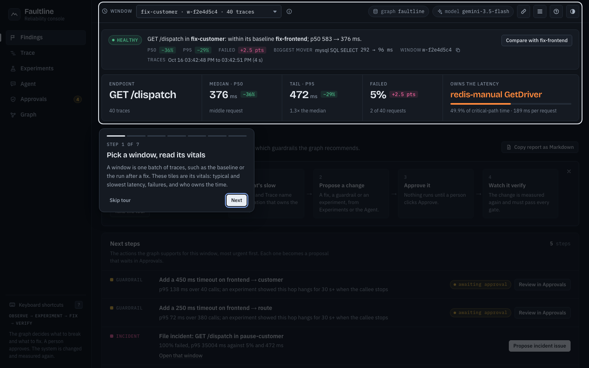
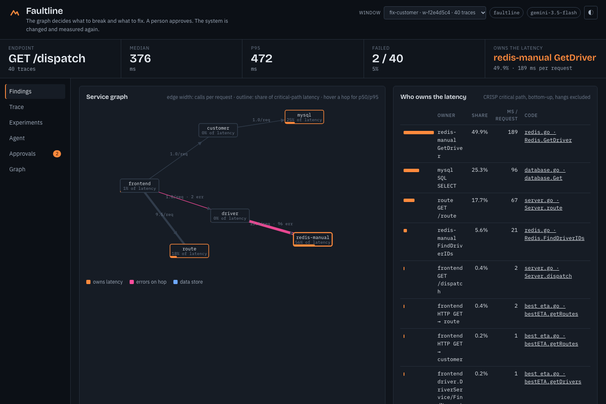
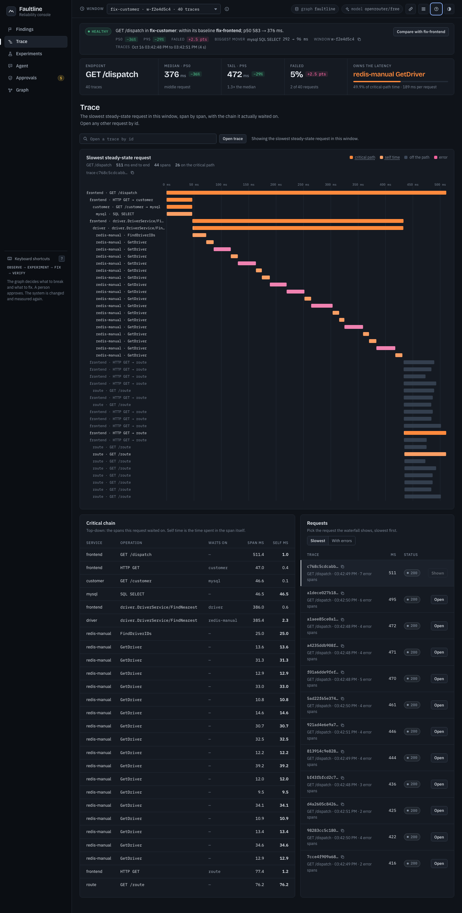
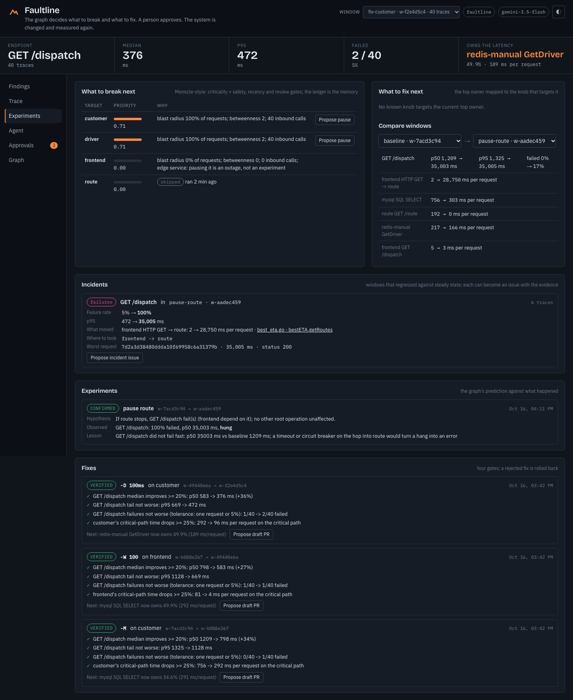
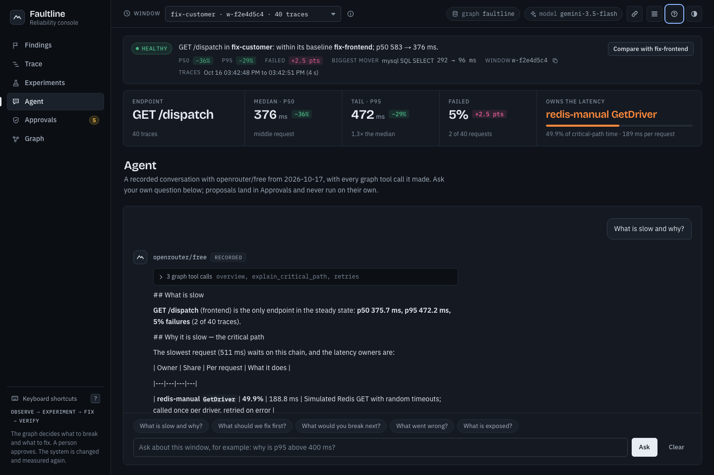

# Faultline

**An agent that learns a system's shape from its traces, keeps it in FalkorDB, and uses the graph to decide what to
break, what to fix, and how to prove it.**

Built Oct 16–18, 2026 for the WeMakeDevs × FalkorDB hackathon (Track 1: Agents That Act on Connected Data).
Research, prior art and the graph model: [docs/ANALYSIS.md](docs/ANALYSIS.md) · story: [docs/PROJECT_STORY.md](docs/PROJECT_STORY.md) ·
demo script: [docs/DEMO.md](docs/DEMO.md) · **Live site:** _coming before submission_ · **Video:** _coming before submission_

## See it in 30 seconds



A first visit opens a seven-step tour; the ? button in the top bar replays it, and a Start here card gives the four-step recipe.



The graph says who owns the latency, which hops fan out, what hangs instead of failing, and that nothing has redundancy. Each line is a Cypher query.



The slowest steady-state request as a waterfall: the spans it actually waited on in ember, the rest in slate, errors in pink.



Pause `route`: the graph predicted the outage, the run confirmed it, and found that the endpoint hangs 35 s instead of failing. Apply a fix: four gates, VERIFIED or REJECTED (and rolled back), and the graph names the next bottleneck.



The agent chooses graph tools, shows every call, and proposes. A person approves; approval is bound to a hash of the evidence.

## Setup (local, about five minutes)

Prerequisites: Docker with Compose, Python 3.12, free ports 6379 (FalkorDB), 3000 (FalkorDB Browser), 8080 (HotROD),
16686 (Jaeger) and 8600 (the console). Change the FalkorDB host ports in `.env` if 6379 or 3000 are taken.

```
git clone https://github.com/DevAnuragT/reachable.git -b faultline faultline && cd faultline
cp .env.example .env          # local defaults; add OPENROUTER_API_KEY, GEMINI_API_KEY or ANTHROPIC_API_KEY for the agent (optional)
make venv                     # Python virtualenv with pinned dependencies
make test                     # 23 tests against the local FalkorDB (needs `make up` first)
```

```
make up          # Jaeger + HotROD (4 service containers) + FalkorDB
make baseline    # 40 parallel /dispatch requests -> a Window in FalkorDB with critical paths and findings
make report      # critical-path owners, single points of failure, fan-out, hangs
make experiment  # pause `route`: the graph predicts the blast radius, the run confirms or refutes it
make fix         # apply HotROD's -M fix to `customer`; four gates decide VERIFIED / REJECTED; the graph names the next owner
make run         # the site on http://localhost:8600: findings, experiments, agent, approvals, Cypher

.venv/bin/python -m faultline.cli agent "What should we fix first?"   # Gemini proposes; nothing runs
.venv/bin/python -m faultline.cli actions                              # the proposal, with its evidence hash
.venv/bin/python -m faultline.cli approve act-xxxxxxxx                 # human approval -> apply -> re-measure -> verdict
```

**How it decides.** Critical paths (CRISP) say who owns the latency. Betweenness and reverse reachability say who is a
single point of failure and what breaks if it stops. The hypothesis of a chaos experiment has three checkable parts: which
operations fail, which services keep answering (called before the target in the request's measured call order), and which
are starved (only called after it). Each part can be refuted by the observed window. Fixes are judged by gates between two
windows and rolled back if rejected, including on errors.

**Remedies, not knobs.** The graph names a remedy class from evidence it can show: *contention* (an operation gets slower the
more of it is in flight), *serialized fan-out* (ten calls per request run three at a time), *per-call cost* (one expensive
operation on the critical path), *hang* (an experiment showed no timeout), *retry storm*. The environment supplies the
actuator for each class, if it has one: here HotROD's flags, in production a feature flag, a pool size or a Helm value
(`experiments.ACTUATORS`). A remedy without an actuator is still reported as advice; nothing is invented as a command.
The experiment planner ranks targets the way Netflix's Monocle did (criticality × safety, recency, review gate), with
the experiment ledger in the graph as its memory. The agent (tool-calling, on OpenRouter, Claude or Gemini) only reads the
graph and proposes; a human approves; approval is bound to a hash of the evidence.

**Why FalkorDB is load-bearing.** Spans, windows, experiments, fixes, approvals and the agent's memory are one property graph.
The critical-path shares are an aggregation over `Span-[:OF]->Trace`; single points of failure come from `algo.betweenness`;
the blast radius of stopping a service is a variable-length `CALLS` path query; every verdict is a comparison between two
`Window` nodes; every approval re-derives its evidence from the graph. Remove FalkorDB and nothing here can decide anything.

**Data.** Every number comes from synthetic traffic against Jaeger's public HotROD demo app running on the author's machine.
No private, personal or third-party data is loaded.

**AI assistance, disclosed.** Built with AI coding assistants (Claude via Claude Code, including a design subagent for the
console). The graph model, the algorithms, the gates, the actuator design and the measurements are the author's decisions
and were verified by the author; `docs/PROJECT_STORY.md` has the full account and a rehearsal section explaining each part.

Measured on Oct 16 (see `docs/ANALYSIS.md` for the research):

- Baseline: MySQL owns 64% of steady-state critical-path latency; Redis is called 13.5 times per request; every path runs through `customer` and `driver`.
- Pause `route`: the graph predicted `GET /dispatch` fails; it did, but it **hung for 35 s instead of failing**. Lesson recorded: the hop into `route` has no timeout.
- Fix `-M` (customer): p50 1191 → 788 ms, VERIFIED on four gates; the graph says MySQL still owns 34%, so the next fix is `-D`.
- Fix `-W 100` (frontend): p50 788 → 593 ms, VERIFIED; route's queueing time on the critical path gone.


## Deploying the public site

Read-only mode: `FAULTLINE_PUBLIC=true`. Proposals and approvals refuse in the backend (`faultline/guard.py`, tested in
`tests/test_actions.py` and `tests/test_api.py`); the experiments, fixes and the agent conversation shown are recorded runs
from the graph and `data/frozen/agent.json`. Seed a cloud graph by running the CLI with `FALKORDB_HOST/PORT/USERNAME/PASSWORD`
pointing at it and `GRAPH_NAME=faultline` (it can share a FalkorDB instance with other graphs). The site is a FastAPI app:
`render.yaml` deploys it on Render's free plan from the Dockerfile; any host that runs a container works the same way.

## Graph model

```
(:Service {name})-[:EXPOSES]->(:Operation {key, name, service})
(:Service)-[:CALLS {window, count, errors, p50_ms, p95_ms, per_trace}]->(:Service)     one edge per window
(:Operation)-[:INVOKES {window, ...}]->(:Operation)
(:Window {id, label, traces})  (:Trace {id, root, duration_ms, status, errors})-[:IN]->(:Window)
(:Span {service, op, peer, kind, error, critical, self_us})-[:OF]->(:Trace)  -[:CHILD_OF]->(:Span)  -[:ON]->(:Operation)
(:Finding {kind, severity, detail})-[:ABOUT]->(:Service)
(:Experiment {hypothesis, verdict, lesson})-[:TARGETS]->(:Service) -[:BASELINE|OBSERVED]->(:Window) -[:PREDICTED_IMPACT|ACTUAL_IMPACT]->(:Operation)
(:Fix {flags, verdict, gates, next_owner})-[:TARGETS]->(:Service) -[:BEFORE|AFTER]->(:Window)
(:Action {type, payload, hash, status})-[:EXECUTED_AS]->(:Experiment|:Fix)
```

Algorithms used: `algo.betweenness` (single points of failure), variable-length `CALLS` paths (blast radius), CRISP critical
path computed per trace and stored on spans, `percentileDisc` per window (steady state), window-to-window diffs (gates, drift).

## Tests

`make test`: critical-path algorithm (sequential, parallel, overlapping, orphan spans), end-to-end ingest and analysis on a
recorded HotROD trace set, approval ledger (stale and tampered evidence refused, public mode cannot propose or execute,
REFUTED-until-reviewed planner gate), and the HTTP API: overview, critical chain and waterfall, planner, offline agent, proposals, public-mode refusals, read-only Cypher.

## From finding to pull request

Every change the agent proposes can leave the graph as something a team reviews:

- **Draft PR** (`propose_pr <fix id | guardrail action id | experiment id>`): a VERIFIED fix becomes `deploy/docker-compose.fix.yml`
  plus a gate report under `docs/changes/`; an approved guardrail becomes its Istio policy YAML plus a note; an experiment that
  regressed the endpoint becomes an incident report under `docs/incidents/`. With `GITHUB_REPO=owner/repo` and the GitHub CLI
  logged in, approval creates the branch, commits the files through the API and opens a draft PR; without it, the files and the
  PR body are written under `out/pr/`.
- **Incident issue** (`propose_incident_issue <window>`): any window whose failure rate or p95 regressed against the steady-state
  window becomes an issue with the before/after table, the owner that moved, the hop and the code to look at, and the worst trace.
- **The agent reads the code it cites.** `read_source(service, op)` returns the function behind an operation (file, line
  range, code, link) from a local checkout (`SOURCE_ROOT`) or the public repository, and the rules forbid describing code it
  has not read. `propose_code_change(service, op, patch, summary)` takes a unified diff: it is rejected unless every removed
  line exists in that function, and on approval it becomes a draft PR carrying the patch, the quoted source, the evidence and
  the code hash. If the source changes before approval, the action goes stale. The graph still decides where and why; the
  model drafts what; a person approves; nothing is applied to a running system by Faultline.
- **Code pointers**: spans carry OpenTelemetry's `code.function.name` / `code.file.path` / `code.line.number` when the
  instrumentation emits them; for HotROD, which does not, an explicit source map (`faultline/code.py`) names the file and function
  behind each operation and the config symbol behind each flag. The site links them; the agent cites them; nothing is guessed.

Approval for all of these is the same hashed-evidence path as experiments and fixes, and public mode refuses them.

## The agent's model

The agent runs on whichever provider has credentials, in this order: **Claude** (`ANTHROPIC_API_KEY`; model `claude-opus-5-5`,
override with `CLAUDE_MODEL`), then **OpenRouter** (`OPENROUTER_API_KEY`; model `openrouter/free` by default, which picks a
tool-capable free model, override with `OPENROUTER_MODEL`, fallbacks in `OPENROUTER_FALLBACK_MODELS`), then **Gemini**
(`GEMINI_API_KEY`, with a fallback chain), then an **offline** mode that answers from the same graph tools without a model.
Force one with `AGENT_PROVIDER`. OpenRouter's free tier allows 20 requests a minute and 50 a day (1,000 a day once $10 of
credits were ever bought); an answer is three to five requests, and when OpenRouter runs out the same turn continues on Gemini. The tools, the proposals and the approval path are identical on all three;
only the prose differs. Every tool call is recorded and shown.

## MCP

`pip install -r requirements-mcp.txt`, then add to your client:

```json
{"mcpServers": {"faultline": {"command": "python", "args": ["-m", "faultline.mcp_server"], "cwd": "/path/to/faultline"}}}
```

Eighteen tools: everything the agent can read or propose, nothing that executes.
