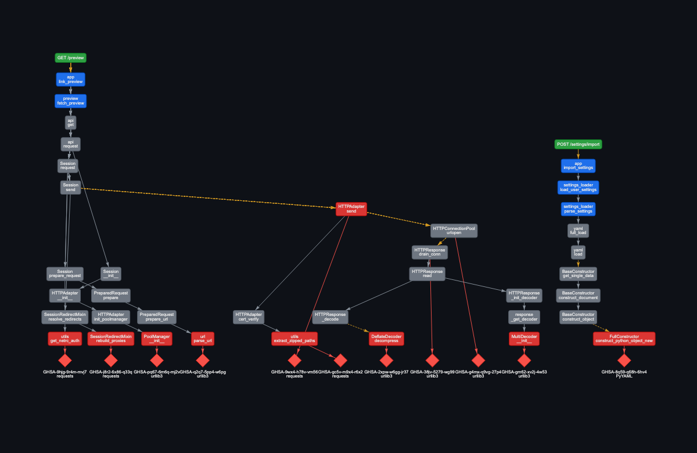
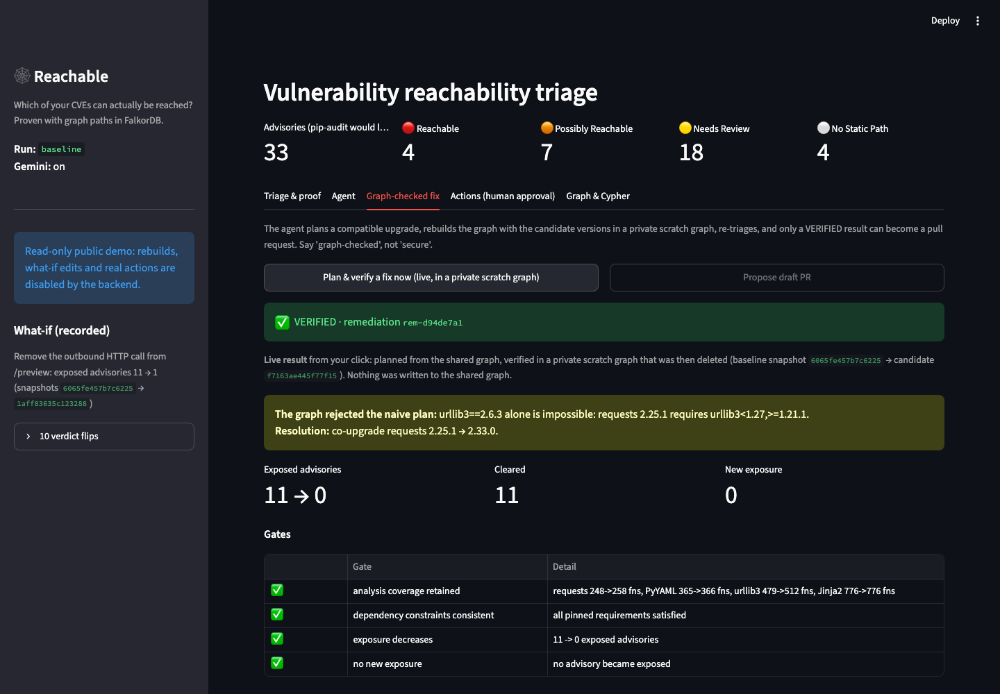
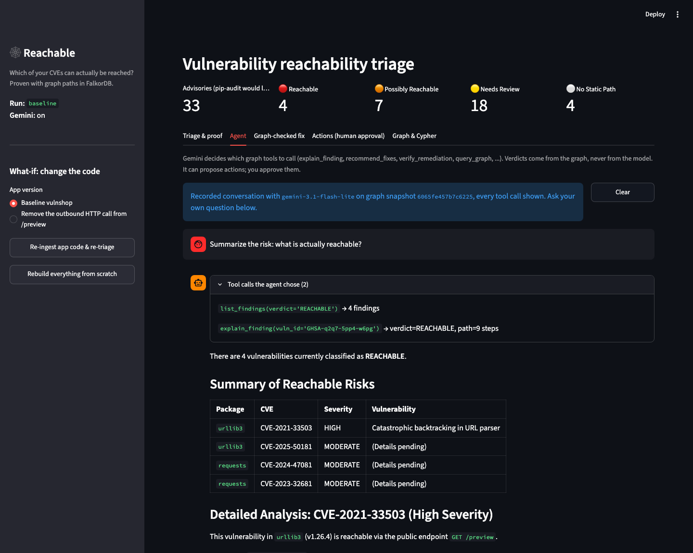

# The agent that checks its own fix: graph-proven vulnerability triage with FalkorDB

Dependency scanners give you a list. For a six-package Flask app, OSV reports 33 advisories, and the list can't say
which ones matter. I built **Reachable** for the FalkorDB Graph Hacks hackathon (Track 1, agents that act on connected
data) around one idea: an agent should not touch your dependencies until a graph shows the vulnerable code is reachable,
and should not open a pull request until a *rebuilt* graph checks the fix.

## Three layers, one graph

* **Code:** endpoints → functions → calls, extracted with Python's `ast` from the app *and* the real source of each
  pinned package (nothing is installed or executed).
* **Supply chain:** packages and their dependency edges, carrying the requirement specifier (`<1.27,>=1.21.1`).
* **Advisories:** OSV records → affected package → the vulnerable function.

Trust is part of the schema. A call resolved through imports is a `CALLS` edge. A call on an unresolved receiver, or
runtime registry dispatch, is `MAYBE_CALLS`. A function used as a value is `REFERENCES`. "Provable" and "plausible"
become two Cypher queries:

```cypher
WITH v, f, h, shortestPath((h)-[:CALLS*1..14]->(f)) AS p WHERE p IS NOT NULL                    // REACHABLE
WITH v, f, h, shortestPath((h)-[:CALLS|MAYBE_CALLS|REFERENCES*1..14]->(f)) AS p ...             // POSSIBLY_REACHABLE
```

Of the 33 advisories, 11 are exposed. The witness path (for example `GET /preview → … → requests → … →
urllib3.parse_url`, 8 exact hops) is stored on the finding as proof.



## The agent that rejected its own plan

The naive fix is "bump every exposed package to its fixed version". For urllib3 that means 2.6.3, which is impossible:
`requests 2.25.1` requires `urllib3<1.27`. That constraint lives on a graph edge, so the planner reads it, rejects the bump
on its own and finds the co-upgrade (`requests 2.33.0`).

Then the part I like most: the candidate versions are built into a **private scratch graph** (real sources, real
advisories) and re-triaged. Gates decide the outcome: analysis coverage retained, constraints consistent, exposure
decreases, no new exposure. Here: 11 exposed → 0, coverage retained (urllib3 479 → 512 analysed functions). If the
upgraded packages had been analysed less than before, the status would be `UNVERIFIED`, never "fixed". Only a `VERIFIED`
result can become a draft PR.



The scratch graph is a second graph in the same FalkorDB instance. On the public site any visitor can press "Plan &
verify" and watch this happen live; the scratch graph is private and deleted afterwards, and nothing is written to the
shared graph.

## Authorization that expires

Every proposed action stores a canonical payload (target, content hashes, a hash of the graph snapshot, the witness path)
and its SHA-256. On approval the code checks for tampering, rebuilds the payload from the *current* graph and compares,
and refuses if anything changed. Same verdict but a different witness path? Refused. Edited diff? Refused. The graph
is not just a database here; it is what an approval means.

## Gemini's job

Gemini maps advisories to vulnerable functions (reading the fix-commit diff against a deterministic candidate list) and
runs the tool-calling agent. It never decides reachability, and it cannot execute anything. Every tool it chooses is shown
before its answer. The same tools are exposed over MCP, minus anything that executes.



## What I would not claim

Static Python call graphs are approximate, so `NO_STATIC_PATH` never means "safe". Flask and Werkzeug are not modelled, so
18 advisories stay undecided, and I say so. "Graph-checked" is not "secure". I reviewed the project with a panel of AI
advisors and a judge; their sharpest findings (a false witness path from a bad name-match, an upgrade plan that ignored
version constraints, approvals that only compared verdicts) are the reason those parts exist in their current form.

Code, graph model and queries are in the README. Built with FalkorDB, Gemini and GitHub Copilot CLI.
